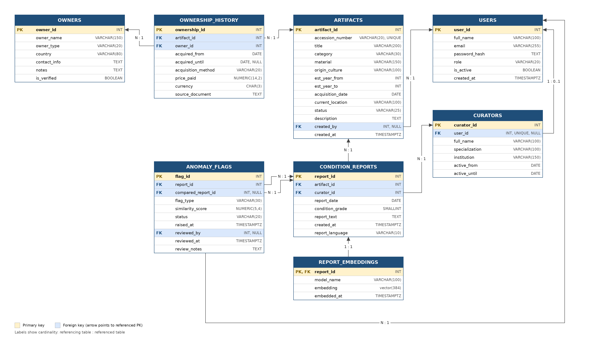

# Relational Schema

Museum/Archive Artifact Provenance & Condition-Report Matching.
This document converts the ER diagram (`docs/er/er-diagram.png`, Chen notation) into the relational schema
implemented in `db/schema/01_core_tables.sql` and `db/schema/02_history_condition_tables.sql`.

Editable source: `relational-schema.drawio`.

---

## 1. Schema in standard notation

Primary keys are underlined. Foreign keys are marked with `*` and the referenced key is given underneath.

**USERS** (<u>user_id</u>, full_name, email, password_hash, role, is_active, created_at)

**CURATORS** (<u>curator_id</u>, user_id\*, full_name, specialization, institution, active_from, active_until)
&nbsp;&nbsp;&nbsp;&nbsp;user_id → USERS.user_id &nbsp;(UNIQUE, NULLABLE)

**OWNERS** (<u>owner_id</u>, owner_name, owner_type, country, contact_info, notes, is_verified)

**ARTIFACTS** (<u>artifact_id</u>, accession_number, title, category, material, origin_culture, est_year_from, est_year_to, acquisition_date, current_location, status, description, created_by\*, created_at)
&nbsp;&nbsp;&nbsp;&nbsp;created_by → USERS.user_id

**OWNERSHIP_HISTORY** (<u>ownership_id</u>, artifact_id\*, owner_id\*, acquired_from, acquired_until, acquisition_method, price_paid, currency, source_document)
&nbsp;&nbsp;&nbsp;&nbsp;artifact_id → ARTIFACTS.artifact_id ; owner_id → OWNERS.owner_id

**CONDITION_REPORTS** (<u>report_id</u>, artifact_id\*, curator_id\*, report_date, condition_grade, report_text, report_language, created_at)
&nbsp;&nbsp;&nbsp;&nbsp;artifact_id → ARTIFACTS.artifact_id ; curator_id → CURATORS.curator_id

**REPORT_EMBEDDINGS** (<u>report_id\*</u>, model_name, embedding, embedded_at)
&nbsp;&nbsp;&nbsp;&nbsp;report_id → CONDITION_REPORTS.report_id

**ANOMALY_FLAGS** (<u>flag_id</u>, report_id\*, compared_report_id\*, flag_type, similarity_score, status, raised_at, reviewed_by\*, reviewed_at, review_notes)
&nbsp;&nbsp;&nbsp;&nbsp;report_id → CONDITION_REPORTS.report_id ; compared_report_id → CONDITION_REPORTS.report_id ; reviewed_by → USERS.user_id

---

## 2. ER to relational mapping

| # | Rule | Applied to |
|---|---|---|
| 1 | **Strong entities become tables.** Each key attribute becomes the primary key. | USER, CURATOR, OWNER, ARTIFACT, CONDITION_REPORT and ANOMALY_FLAG become `users`, `curators`, `owners`, `artifacts`, `condition_reports` and `anomaly_flags`. |
| 2 | **A weak entity becomes a table whose key includes the owner's key.** | REPORT_EMBEDDING cannot exist without its CONDITION_REPORT (identifying relationship HAS_EMBEDDING), so `report_embeddings.report_id` is both its primary key and a foreign key. Deleting a report deletes its embedding (`ON DELETE CASCADE`). |
| 3 | **Composite attributes are flattened** into one column per component. | `estimated_period` becomes `est_year_from` and `est_year_to`. `active_period` becomes `active_from` and `active_until`. |
| 4 | **Derived attributes are not stored.** | `years_in_collection` (ARTIFACT) and `duration` (OWNED_BY) are computed in queries from `acquisition_date` and from `acquired_from` / `acquired_until`. Storing them would make them go stale. |
| 5 | **1:1 with partial participation on both sides: put a UNIQUE, nullable foreign key on one side.** | HAS_ACCOUNT (CURATOR to USER). The key goes on the CURATOR side as `curators.user_id` (UNIQUE, NULL). A curator exists independently of any login (most historical curators from the 1960s–2000s never had one), so the link is optional and those curators simply have `NULL`. UNIQUE keeps it 1:1: one account maps to at most one curator. USERS needs no knowledge of curators. |
| 6 | **1:N relationships put the foreign key on the N side.** | DOCUMENTS: `condition_reports.artifact_id`. WRITES: `condition_reports.curator_id`. REGISTERS: `artifacts.created_by`. FLAGS and COMPARED_AGAINST: two separate foreign keys from `anomaly_flags` to `condition_reports` (`report_id`, `compared_report_id`). REVIEWS: `anomaly_flags.reviewed_by`. |
| 7 | **M:N relationships become a new table** holding both foreign keys plus the relationship's own attributes. | OWNED_BY (ARTIFACT to OWNER) becomes `ownership_history`, carrying `acquired_from`, `acquired_until`, `acquisition_method`, `price_paid`, `currency` and `source_document`. It has a **surrogate primary key** (`ownership_id`) rather than (`artifact_id`, `owner_id`), because the same owner can own the same artifact more than once (for example sold, then bought back). Overlapping periods for one artifact are rejected by an exclusion constraint instead. |
| 8 | **Participation decides NULL.** Total participation gives a `NOT NULL` foreign key; partial participation gives a nullable one. | Every report must have an artifact and a curator (`NOT NULL`). `artifacts.created_by`, `curators.user_id`, `anomaly_flags.compared_report_id` and `anomaly_flags.reviewed_by` are nullable. |

---

## 3. Normalisation check (up to 3NF)

**First normal form.** Every column holds a single atomic value. The embedding is one `vector(384)` value, not a repeating group of 384 columns. Composite attributes were already flattened (rule 3), and no table has a multi-valued column.

**Second normal form.** Every table has a single-column primary key, so no non-key attribute can depend on only part of a key. All tables are in 2NF.

**Third normal form (per table).**

- **USERS**: every attribute describes the user directly. `role` is a value from a fixed set, not a lookup of another entity's attributes.
- **CURATORS**: name, specialisation, institution and active period all depend on `curator_id`. Login details live in USERS and are reached through `user_id`, not copied here.
- **OWNERS**: all attributes describe the owner. Nothing about an owner's artifacts is stored here.
- **ARTIFACTS**: descriptive attributes depend only on `artifact_id`. Owner details are not stored here (they live in OWNERS via OWNERSHIP_HISTORY). *Note:* `acquisition_date` overlaps with the museum's own row in `ownership_history` (`owner_id = 1`, `acquired_from`). It is kept deliberately as a catalogue field that is easy to read, and the seed data keeps the two consistent.
- **OWNERSHIP_HISTORY**: owner name, type and country are not repeated here, only `owner_id`. Dates, method, price, currency and source describe this specific period of ownership, so they depend on `ownership_id`.
- **CONDITION_REPORTS**: curator name and specialisation are not repeated in each report, only `curator_id`. Artifact details are reached through `artifact_id`.
- **REPORT_EMBEDDINGS**: `model_name`, `embedding` and `embedded_at` all depend on `report_id`. It is separate from CONDITION_REPORTS so a different model can be used later without altering the archival report rows.
- **ANOMALY_FLAGS**: every attribute describes the flag. The text of the flagged and compared reports is not copied, only their keys.

No transitive dependencies remain (no non-key attribute determines another non-key attribute), so all eight relations are in 3NF.

---

## 4. Constraints

### USERS
| Type | Constraint |
|---|---|
| PK | `user_id` |
| UNIQUE | `lower(email)` (unique index `users_email_lower_uq`, so email is case-insensitively unique) |
| CHECK | `role IN ('admin','curator','researcher')`; `users_email_format` (basic email pattern); `users_password_is_bcrypt` (the stored value must look like a bcrypt hash, so plain-text passwords are rejected) |
| Default | `is_active = TRUE`, `created_at = now()` |

### CURATORS
| Type | Constraint | Why |
|---|---|---|
| PK | `curator_id` | |
| FK | `user_id → users(user_id) ON DELETE SET NULL` | Removing a login must not delete the curator, because the curator still authored historical reports. |
| UNIQUE | `user_id` | One user account maps to at most one curator (1:1). |
| CHECK | `curators_active_period`: `active_until IS NULL OR active_until >= active_from` | |

### OWNERS
| Type | Constraint |
|---|---|
| PK | `owner_id` |
| CHECK | `owner_type IN ('individual','institution','dealer','auction_house','government','unknown')` |
| Default | `is_verified = FALSE` (added with ALTER) |
| Index | `idx_owners_type (owner_type)` |

### ARTIFACTS
| Type | Constraint | Why |
|---|---|---|
| PK | `artifact_id` | |
| FK | `created_by → users(user_id) ON DELETE SET NULL` | The catalogue record survives if the registering user is removed. |
| UNIQUE | `accession_number` | |
| CHECK | `accession_number ~ '^[A-Z]{2,5}-[0-9]{4}-[0-9]{4}$'`; `category IN (...)`; `status IN ('on_display','in_storage','on_loan','under_conservation','deaccessioned')`; `artifacts_dating_range` (`est_year_to >= est_year_from`); `artifacts_acquired_after_creation` (acquisition year must not precede the estimated creation year; added with ALTER) | |
| Index | `idx_artifacts_category_status (category, status)` | Common filter on the catalogue screen. |

### OWNERSHIP_HISTORY
| Type | Constraint | Why |
|---|---|---|
| PK | `ownership_id` (surrogate) | The same owner can hold the same artifact more than once. |
| FK | `artifact_id → artifacts(artifact_id) ON DELETE RESTRICT` | Provenance is archival, so an artifact with a history cannot be deleted. |
| FK | `owner_id → owners(owner_id) ON DELETE RESTRICT` | Same reason. |
| CHECK | `acquisition_method IN ('purchase','gift','bequest','excavation','field_collection','loan','transfer','unknown')` | |
| CHECK | `price_paid IS NULL OR price_paid >= 0` | |
| CHECK | `currency IS NULL OR currency ~ '^[A-Z]{3}$'` | ISO-style currency code. |
| CHECK | `oh_valid_period`: `acquired_until IS NULL OR acquired_until >= acquired_from` | `NULL` means current owner. |
| CHECK | `oh_price_needs_currency`: `price_paid IS NULL OR currency IS NOT NULL` | A price without a currency is meaningless. |
| EXCLUDE | `oh_no_overlapping_ownership`: `EXCLUDE USING gist (artifact_id WITH =, daterange(acquired_from, acquired_until, '[]') WITH &&)` | No two ownership periods of one artifact may overlap, which also means at most one current owner. Needs the `btree_gist` extension. |
| Index | `idx_oh_owner (owner_id)` | |

### CONDITION_REPORTS
| Type | Constraint | Why |
|---|---|---|
| PK | `report_id` | |
| FK | `artifact_id → artifacts(artifact_id) ON DELETE RESTRICT` | Archival records must never silently disappear. |
| FK | `curator_id → curators(curator_id) ON DELETE RESTRICT` | Same reason. |
| UNIQUE | `cr_one_per_curator_per_day (artifact_id, curator_id, report_date)` | Prevents accidental duplicate entries. |
| CHECK | `report_date >= DATE '1900-01-01'`; `condition_grade BETWEEN 1 AND 5`; `char_length(btrim(report_text)) >= 30` | Rejects impossible dates, out-of-scale grades and empty reports. |
| Default | `created_at = now()`; `report_language = 'en'` (added with ALTER) | |
| Index | `idx_cr_artifact_date (artifact_id, report_date)`; `idx_cr_curator (curator_id)` | "All reports of one artifact in date order" is the most common access pattern. |

### REPORT_EMBEDDINGS
| Type | Constraint | Why |
|---|---|---|
| PK / FK | `report_id → condition_reports(report_id) ON DELETE CASCADE` | An embedding is derived data, so it goes when its report goes. |
| Type | `embedding vector(384)` | Fixed dimension matches `all-MiniLM-L6-v2`; other sizes are rejected. |
| Default | `model_name = 'all-MiniLM-L6-v2'`; `embedded_at = now()` | |
| Index | `idx_report_embeddings_hnsw` using HNSW with `vector_cosine_ops` | Approximate nearest-neighbour search by cosine distance. |

### ANOMALY_FLAGS
| Type | Constraint | Why |
|---|---|---|
| PK | `flag_id` | |
| FK | `report_id → condition_reports(report_id) ON DELETE CASCADE` | Flags are derived, so they are removed with the report. |
| FK | `compared_report_id → condition_reports(report_id) ON DELETE CASCADE` | Same reason. Nullable because not every flag compares against another report. |
| FK | `reviewed_by → users(user_id) ON DELETE RESTRICT` | `SET NULL` would break `af_review_complete`; users are deactivated, not deleted. |
| UNIQUE | `af_no_duplicate_flag (report_id, compared_report_id, flag_type)` | |
| CHECK | `flag_type IN ('rapid_degradation','unexplained_improvement','inconsistent_description','possible_mislabel','possible_forgery')`; `status IN ('open','under_review','confirmed','dismissed')`; `similarity_score BETWEEN -1 AND 1` | |
| CHECK | `af_not_self_compare`: `compared_report_id IS NULL OR compared_report_id <> report_id` | A report cannot be compared with itself. |
| CHECK | `af_review_complete`: `status = 'open' OR (reviewed_by IS NOT NULL AND reviewed_at IS NOT NULL)` | A flag cannot be reviewed without a reviewer and timestamp. |
| Index | `idx_af_unresolved (status) WHERE status IN ('open','under_review')` | Partial index: the dashboard only lists unresolved flags, so only those rows are indexed. |

### ON DELETE summary
| Behaviour | Where | Reason |
|---|---|---|
| `RESTRICT` | `ownership_history` (both FKs), `condition_reports` (both FKs), `anomaly_flags.reviewed_by` | Archival data must not be deleted by accident. |
| `CASCADE` | `report_embeddings.report_id`, `anomaly_flags.report_id`, `anomaly_flags.compared_report_id` | Derived data that has no meaning without its report. |
| `SET NULL` | `curators.user_id`, `artifacts.created_by` | The record must outlive the user account. |
